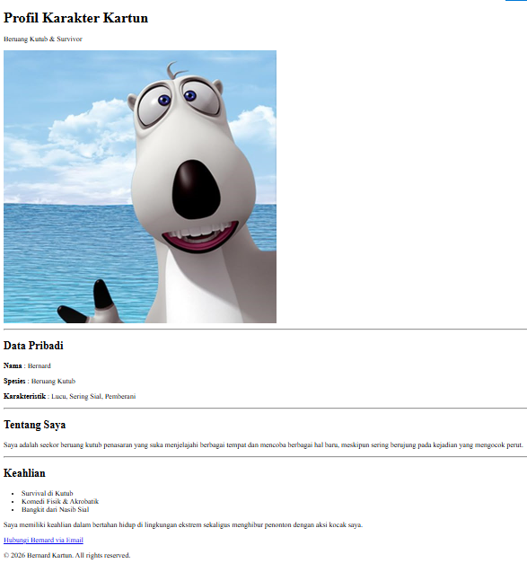
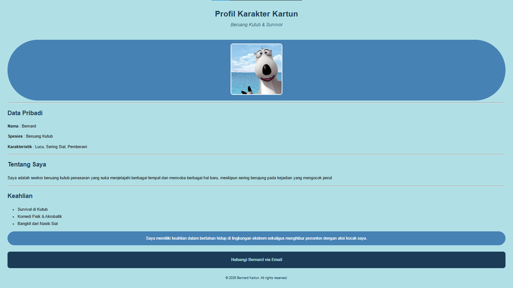

# Dokumentasi Tugas Individu — Pertemuan 3 (CSS Inline)

## Identitas Mahasiswa
* **Nama:** Muhammad Farrel Rizky
* **NPM:** 4525210117
* **Mata Kuliah:** Prak. Desain Web

---

## 1. Hasil Tampilan (Sebelum & Sesudah)

### A. Tampilan Sebelum Modifikasi (Standard HTML)

### B. Tampilan Sesudah Modifikasi (Menggunakan CSS Inline)

---

## 2. Penjelasan Tugas & Penerapan
* **Penerapan 4 Format Warna Berbeda:**
  1. *Color Name*: `powderblue` (Background utama/body)
  2. *HEX*: `#1c3b57` & `#4682b4` (Judul, kontainer, dan footer)
  3. *RGBA*: `rgba(28, 59, 87, 0.85)` (Teks sub-judul profesi transparan)
  4. *RGB*: `rgb(176, 224, 230)` (Tautan link email pada bagian kontak)
* **Penerapan Minimal 10 Properti CSS Inline:**
  Menggunakan properti seperti `background-color`, `color`, `font-family`, `font-size`, `font-weight`, `text-align`, `margin`, `padding`, `border-radius`, `border`, `line-height`, `object-fit`, dan `text-decoration`.

---

## 3. Masalah dan Solusi
* **Masalah:** Penulisan gaya menggunakan CSS Inline membuat struktur kode HTML menjadi sangat panjang dan berulang-ulang pada setiap elemen. Hal ini menyulitkan proses pemeliharaan (*maintenance*) jika ingin mengubah tema secara massal.
* **Solusi:** CSS Inline sangat efektif digunakan untuk uji coba atau perubahan cepat (*quick fix*) berskala kecil. Untuk proyek web yang lebih besar, disarankan menggunakan *External CSS* agar prinsip pemisahan struktur dan desain (*Separation of Concerns*) dapat diterapkan dengan optimal.