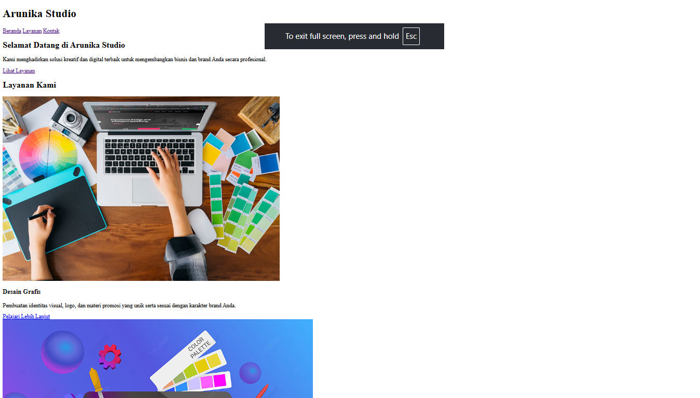
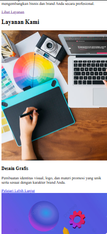
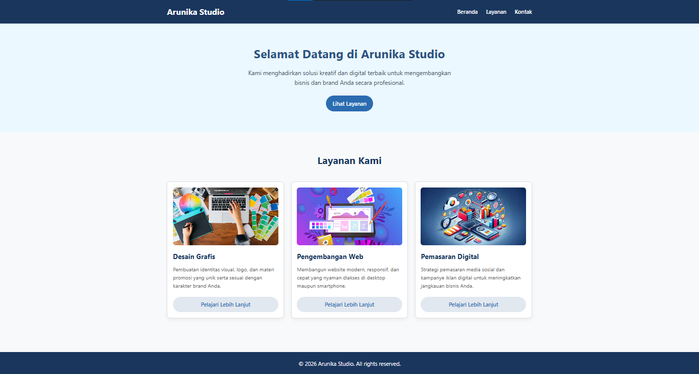
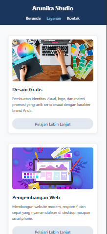

# LAPORAN PRAKTIKUM DESAIN WEB

**Pertemuan 4: External CSS, Box Model, & Responsive Layout**

### Identitas Praktikan

* **Nama**        : Muhammad Farrel Rizky

* **NPM**         : 4525210117

* **Mata Kuliah** : Prak. Desain Web (Room AI)

* **Studi Kasus** : Landing Page Arunika Studio

## 1. Deskripsi Tugas

Praktikum ini bertujuan untuk membangun landing page Arunika Studio dengan struktur berkas yang rapi dan terpisah (`index.html` dan `style.css`). Konten halaman terdiri dari **Header**, **Hero**, **Tiga Layanan (Card)**, dan **Footer**.

Halaman ini dirancang agar responsif menggunakan Flexbox dan CSS Media Query. Saat diakses menggunakan layar desktop, 3 kartu layanan akan tampil secara horizontal (3 kolom). Ketika diakses via ponsel (< 768px), tampilan kartu akan otomatis berubah menjadi 1 kolom vertikal.

## 2. Bukti Pengumpulan (Tampilan Sebelum & Sesudah)

### A. Tampilan Sebelum Perubahan

> CSS masih menyatu/tersebar di HTML dan tata letak belum responsif.

* **Desktop (Sebelum):**

  

* **Mobile (Sebelum):**

  

### B. Tampilan Sesudah Perubahan

> Menggunakan External CSS, Box Model yang presisi, gambar pendukung pada setiap card, dan layout responsif.

* **Desktop (Sesudah - 3 Kolom):**
  
  

* **Mobile / Inspect Element (Sesudah - 1 Kolom):**

  

## 3. Penjelasan Perubahan, Masalah, dan Solusi

### Penjelasan Perubahan Kode

1. **Pemisahan File CSS (External CSS)**
   Memindahkan seluruh kode gaya ke `style.css` dan dihubungkan pada `index.html` menggunakan tag `<link rel="stylesheet" href="style.css">`.

2. **Penerapan Box Model**

   * Menggunakan `box-sizing: border-box` pada selector universal `*`.

   * Mengatur `padding` dan `margin` secara terukur pada `.card`, `.btn`, dan `.container`.

3. **Penggunaan Class Reusable**

   * `.card`: Digunakan berulang untuk ketiga komponen kartu layanan.

   * `.btn`: Digunakan untuk menyamakan gaya dasar semua tombol.

   * `.container`: Digunakan untuk menjaga batas lebar konten di tengah halaman.

4. **Media Query & Responsive Layout**
   Menggunakan `@media (max-width: 768px)` untuk merubah tata letak `.services-grid` dari arah horizontal menjadi vertikal (`flex-direction: column`).

### Masalah dan Solusi

* **Masalah 1**: Kode CSS awal tersebar di dalam file HTML sehingga sulit dipelihara.

  * **Solusi**: Memisahkan seluruh aturan CSS ke dalam file `style.css`.

* **Masalah 2**: Tampilan 3 card layanan terpotong atau gepeng pada layar berukuran kecil.

  * **Solusi**: Menambahkan `@media (max-width: 768px)` dan menerapkan `flex-direction: column`.

* **Masalah 3**: Proporsi gambar lokal berlainan sehingga tinggi kartu menjadi tidak rata.

  * **Solusi**: Menambahkan properti `object-fit: cover` dan batas tinggi `height: 170px` pada class `.card-img`.

## 4. Struktur Folder Project

```
Arunika-Studio-Project/
├── index.html
├── style.css
├── README.md
└── images/
    ├── desain.jpg
    ├── web.jpg
    ├── marketing.jpg
    ├── desktop-sebelum.png
    ├── mobile-sebelum.png
    ├── desktop-sesudah.png
    └── mobile-sesudah.png

```