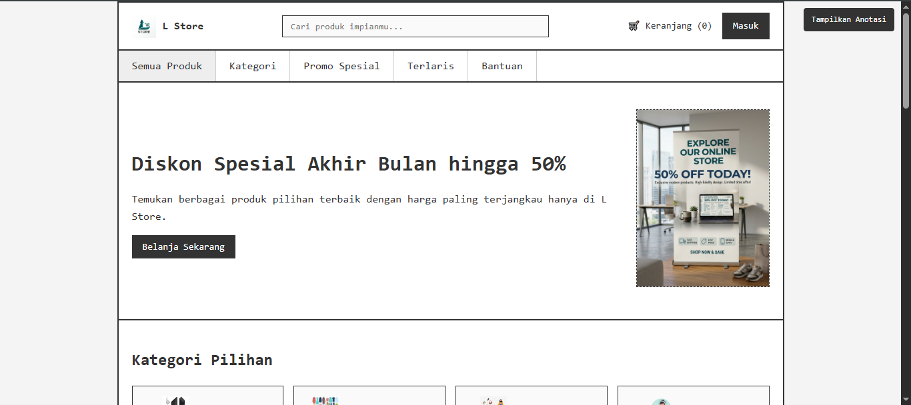
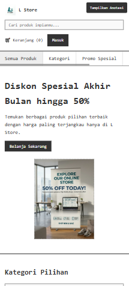

# Tugas Pertemuan 5 - Wireframe Toko Online (L Store)

## Biodata Mahasiswa
Nama: Muhammad Farrel Rizky

NPM: 4525210117

Program Studi: Teknik Informatika

Universitas: Universitas Pancasila

Mata Kuliah: Desain Web

Kelas: A

Pertemuan: 5 - Struktur UI/UX dan Layout Website

## Deskripsi Tugas

**Studi kasus.** Sebuah tim akan membuat portal berita, toko online, atau company profile. Sebelum coding, klien sering mengubah susunan konten, sehingga wireframe dibuat agar perubahan struktur dapat disepakati dengan biaya rendah sebelum desain high fidelity dan implementasi.

**Perintah.** Pilih salah satu: portal berita, toko online, atau company profile. Buat wireframe desktop dan mobile lengkap dengan anotasi fungsi setiap area.

**Pilihan saya.** Toko online (L Store), menggunakan struktur header lengkap dengan pencarian, navbar kategori, dan grid produk.

**Bukti yang dikumpulkan.**
- Source code/folder project (`index.html`, `css/style.css`, `images/`)
- Screenshot hasil pada desktop dan mobile
- Ringkasan 150-250 kata mengenai perubahan, masalah, dan solusi

## Hasil Screenshot

### Desktop

### Mobile

## Penjelasan / Ringkasan (165 kata)

Tugas ini mengimplementasikan wireframe toko online untuk L Store yang optimal diakses pada perangkat desktop maupun mobile. Struktur dokumen menggunakan elemen semantik HTML5 dengan tag header, nav, main, section, article, dan footer yang terorganisir. Sistem navigasi diperkaya dengan kolom pencarian produk (*search bar*), keranjang belanja, serta kategori pilihan berbasis grid 4 kolom dan katalog produk 3 kolom. Gaya visual dipisahkan ke dalam file `css/style.css` menggunakan pendekatan monokrom wireframe, teknik *Flexbox*, dan *CSS Grid* agar fleksibel. Masalah utama dalam pengembangan e-commerce adalah klien sering mengubah letak produk, promo, atau kategori sebelum implementasi final. Solusinya, seluruh layout dirancang menggunakan wireframe beranotasi angka interaktif yang terhubung ke panel legenda di bagian bawah. Pada layar di bawah 768 px, tata letak otomatis menyesuaikan menjadi satu kolom agar nyaman diakses lewat ponsel. Seluruh mekanisme interaksi anotasi dan *toggle* dibangun murni menggunakan HTML dan CSS tanpa bergantung pada JavaScript.