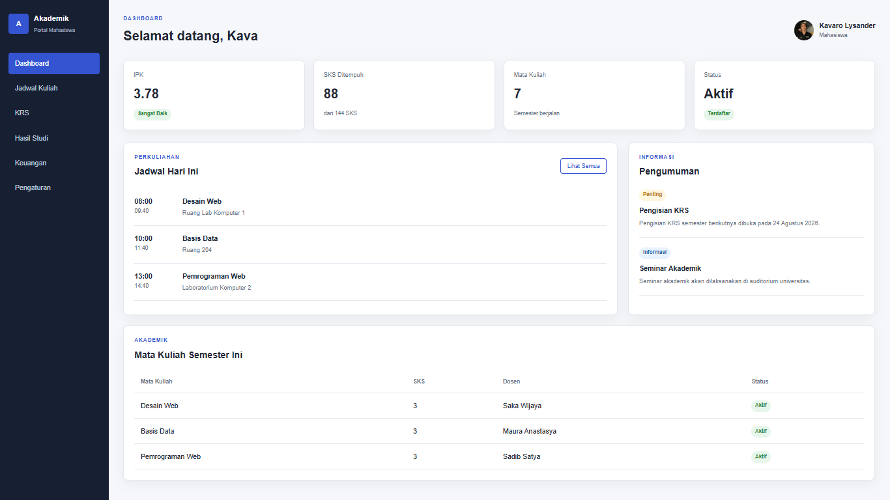
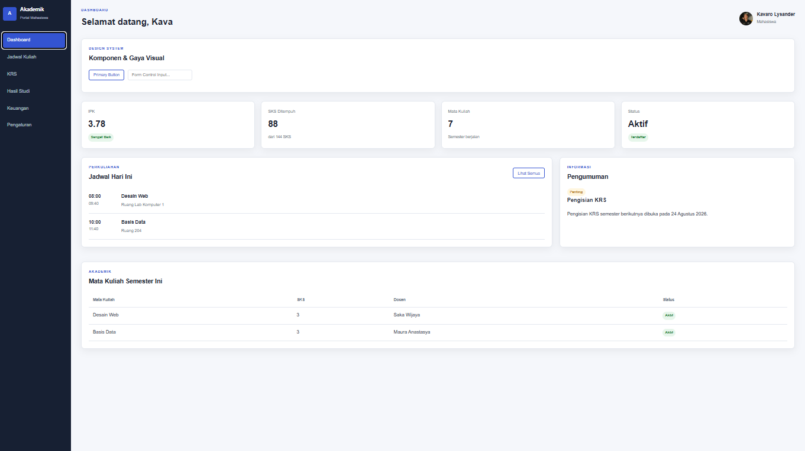
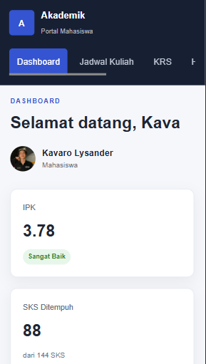
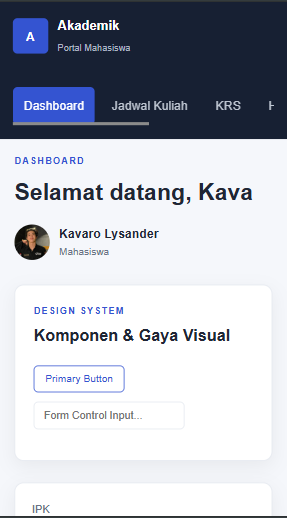

# Tugas Pertemuan 6 - Design System & Mockup Web (Dashboard Mahasiswa)

## Biodata Mahasiswa
- **Nama:** Muhammad Farrel Rizky
- **NPM:** 4525210117
- **Program Studi:** Teknik Informatika
- **Universitas:** Universitas Pancasila
- **Mata Kuliah:** Desain Web
- **Kelas:** A
- **Pertemuan:** 6 - Mockup Halaman Web - Visual Hierarchy, Warna, dan Tipografi

---

## Deskripsi Tugas & Perintah
**Studi Kasus:** Mengembangkan Mockup dari Contoh 2 (Dashboard Mahasiswa) dengan menerapkan Simple Design System yang mencakup *color palette*, *type scale*, *button style*, *card style*, serta minimal satu tampilan versi *mobile*.

**Bukti yang Dikumpulkan:**
1. Source code / folder project (`sebelum/`, `sesudah/`).
2. Screenshot hasil pada desktop dan mobile (menampilkan kondisi **sebelum** dan **sesudah** perubahan).
3. Penjelasan mengenai setiap perubahan, masalah, dan solusi.
4. Dokumentasi Design System yang telah dibuat.

---

## Simple Design System
Design System yang diterapkan pada project ini mencakup komponen visual standar berikut:
- **Color Palette:** Memakai warna utama (*Primary* `#3454d1`), warna pendukung, serta status warna (*Success*, *Warning*, *Info*).
- **Typography (Type Scale):** Skala ukuran font yang konsisten untuk judul (*heading*), teks isi (*body*), dan label.
- **Spacing:** Pengaturan jarak antar elemen yang konsisten menggunakan variabel CSS.
- **Buttons:** Variasi tombol interaktif dengan status *hover* yang selaras.
- **Form Controls:** Elemen *input text* dan kontrol formulir dasar.
- **Cards:** Komponen kontainer kotak/kartu dengan sudut melengkung (*border-radius*) dan bayangan (*shadow*) yang seragam.

---

## Hasil Screenshot (Sebelum vs Sesudah)

### 1. Tampilan Desktop
* **Sebelum (Original Wireframe / Contoh 2):**

  

* **Sesudah (Implementasi Design System & Mockup):**

  

### 2. Tampilan Mobile
* **Sebelum (Original Wireframe / Contoh 2):**

  

* **Sesudah (Implementasi Design System & Mobile Responsive):**

  

---

## Penjelasan Perubahan, Masalah, dan Solusi

### 1. Perubahan yang Dilakukan
Pada tahap pengembangan ini, dilakukan penambahan dan penyempurnaan komponen *Design System* ke dalam struktur dashboard mahasiswa (Contoh 2). Perubahan meliputi penerapan palet warna konsisten (`--primary`, `--surface`, `--border`), standarisasi ukuran tipografi (*Type Scale*), perbaikan gaya tombol interaktif (*Buttons* dan *Form Controls*), serta penyelarasan gaya kartu statistik dan panel konten agar memiliki hierarki visual yang jelas.

### 2. Masalah yang Dihadapi
- **Konsistensi Visual:** Pada versi awal (*sebelum*), beberapa elemen komponen seperti tombol, pembatas panel, dan jarak antar elemen masih menggunakan styling terpisah yang kurang terpusat.
- **Responsivitas Tampilan Kecil:** Saat diuji pada layar perangkat seluler (*mobile*), tata letak beberapa grid statistik dan panel informasi sempat menumpuk atau terpotong sebelum diatur ulang menggunakan *Media Queries*.

### 3. Solusi yang Diterapkan
- Menerapkan pendekatan variabel CSS (`:root`) untuk mengontrol token *Design System* (warna, radius, dan bayangan) sehingga perubahan global dapat dilakukan dengan lebih mudah dan konsisten.
- Menggunakan *CSS Grid* dan *Flexbox* yang dikombinasikan dengan *Media Queries* (`max-width: 700px` dan `1000px`) untuk memastikan struktur menu sidebar berubah menjadi navigasi horizontal yang ramah perangkat *mobile* serta menyusun ulang grid statistik menjadi satu kolom secara rapi.