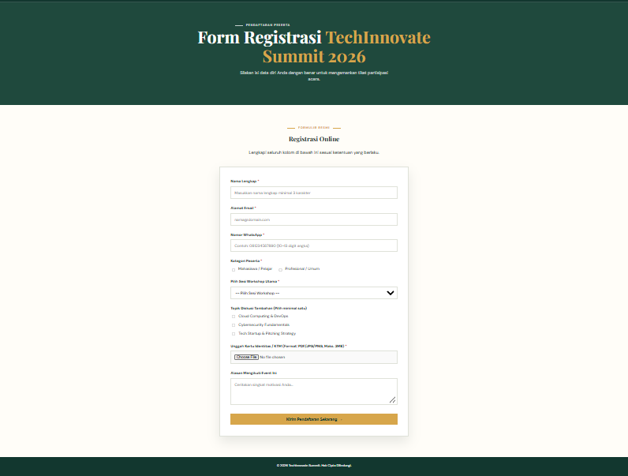
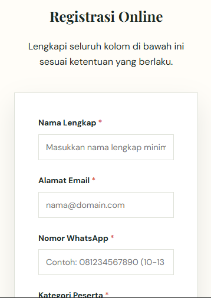

# Tugas Pertemuan 7 - HTML Form Dasar: Input dan Pengiriman Data

## Biodata Mahasiswa
- **Nama:** Muhammad Farrel Rizky
- **NPM:** 4525210117
- **Program Studi:** Teknik Informatika
- **Universitas:** Universitas Pancasila
- **Mata Kuliah:** Desain Web
- **Kelas:** A
- **Pertemuan:** 7 - HTML Form Dasar: Input dan Pengiriman Data

---

## Deskripsi Tugas & Perintah
**Studi Kasus & Tugas Individu:**
1. **Studi Kasus:** Mengintegrasikan form pemesanan makanan pada website Kaciw Resto yang mencakup Nama Pelanggan, Email Pelanggan, Nomor Telepon, Pilihan Menu, dan Catatan Tambahan.
2. **Tugas Individu:** Membangun form registrasi *event* (TechInnovate Summit 2026) yang menggunakan elemen `radio`, `checkbox`, `select`, `textarea`, `upload`, serta minimal 4 aturan validasi. Melakukan pengujian minimal 5 skenario input salah beserta tabel *test case* validasi dan analisis keamanan validasi *server-side*.

**Bukti yang Dikumpulkan:**
1. Source code / folder project (`tugas-form-event/`).
2. Screenshot hasil pada desktop dan mobile (menampilkan kondisi untuk skenario input yang salah/validasi).
3. Tabel *Test Case* validasi (Field, Input Uji, Hasil yang Diharapkan, dan Hasil Aktual).
4. Penjelasan mengenai validasi sisi server (*Server-Side Validation*), perubahan, masalah, dan solusi.

---

## Elemen Form & Aturan Validasi
Form Registrasi Event dirancang dengan memanfaatkan berbagai elemen kontrol input HTML5 dan dilengkapi aturan validasi sebagai berikut:
- **Radio Button:** Pemilihan tipe kategori peserta (Mahasiswa / Profesional).
- **Checkbox:** Pemilihan topik minat tambahan (dapat memilih lebih dari satu).
- **Select Option:** Pemilihan sesi workshop utama.
- **Textarea:** Input alasan/motivasi mengikuti *event*.
- **File Upload (`type="file"`):** Unggah kartu identitas / KTM dengan pembatasan ekstensi file (`accept=".pdf, .jpg, .jpeg, .png"`).
- **Aturan Validasi HTML5 (Minimal 4 Aturan):**
  1. `required`: Wajib diisi pada field Nama, Email, Telepon, Kategori, Workshop, dan Berkas Upload.
  2. `type="email"`: Validasi struktur penulisan alamat email yang sesuai standar.
  3. `minlength="3"`: Memastikan Nama Lengkap diisi minimal 3 karakter.
  4. `pattern="[0-9]{10,13}"`: Memastikan Nomor WhatsApp hanya berisi angka sebanyak 10 hingga 13 digit.

---

## Hasil Screenshot (Desktop & Mobile)

### 1. Tampilan Desktop
- **Form Registrasi Event (Tampilan Desktop / Skenario Validasi):**

  

### 2. Tampilan Mobile
- **Form Registrasi Event (Tampilan Mobile / Skenario Validasi):**

  

---

## Tabel Test Case Validasi
Berikut adalah hasil pengujian skenario input salah pada Form Registrasi Event:

| No | Field / Input | Skenario Input Uji (Salah) | Hasil yang Diharapkan | Hasil Aktual | Status Validasi |
|:--:|---|---|---|---|:--:|
| 1 | **Nama Lengkap** | Dikosongkan lalu menekan tombol Submit | Browser menampilkan tooltip peringatan: *"Please fill out this field"* | Browser memblokir pengiriman & fokus otomatis ke input Nama | **Valid (Client-side)** |
| 2 | **Alamat Email** | Mengisi teks tanpa simbol `@` (Contoh: `farrelgmail.com`) | Browser menolak submit & meminta penambahan simbol `@` pada email | Browser menampilkan tooltip: *"Please include an '@' in the email address..."* | **Valid (Client-side)** |
| 3 | **Nomor WhatsApp** | Mengisi karakter huruf atau kurang dari 10 digit (Contoh: `08123`) | Pola `pattern="[0-9]{10,13}"` tidak terpenuhi, form gagal dikirim | Browser menampilkan tooltip format/pola angka tidak sesuai | **Valid (Client-side)** |
| 4 | **Sesi Workshop** | Membiarkan opsi default (`-- Pilih Sesi Workshop --`) | Atribut `required` pada elemen `<select>` mendeteksi opsi bernilai kosong | Form tertahan dan memunculkan instruksi memilih salah satu opsi | **Valid (Client-side)** |
| 5 | **Unggah Berkas** | Mengunggah dokumen berformat terlarang (Contoh: `.docx` atau `.exe`) | Atribut `accept=".pdf, .jpg, .jpeg, .png"` memfilter tipe file | File eksternal yang tidak sesuai ekstensi terfilter secara otomatis | **Valid (Client-side)** |

---

## Penjelasan Validasi Sisi Server (Server-Side Validation)

### Mengapa Validasi Server Tetap Wajib Dilakukan?
Meskipun validasi sisi klien (*Client-Side Validation*) menggunakan atribut bawaan HTML5 (`required`, `type="email"`, `pattern`, dll.) memberikan umpan balik langsung (*real-time feedback*) kepada pengguna, validasi ini **tidak menjamin keamanan aplikasi**. Validasi pada browser pengguna dapat dengan mudah diabaikan atau dilompati dengan cara:
1. Mengedit DOM elemen HTML melalui menu *Inspect Element* (Developer Tools).
2. Menonaktifkan fungsi JavaScript atau aturan HTML5 pada browser.
3. Mengirimkan request HTTP POST secara langsung menggunakan tools API seperti Postman, cURL, atau skrip otomatis (*bot script*).

Oleh karena itu, **validasi sisi server (Server-Side Validation) tetap bersifat wajib (mandatory)** sebagai garda pertahanan utama keamanan aplikasi web.

### Hal-hal yang Wajib Divalidasi di Server:
1. **Pembersihan & Sanitasi Data (Data Sanitization):** Memastikan seluruh karakter berbahaya disaring untuk mencegah serangan **SQL Injection** dan **Cross-Site Scripting (XSS)**.
2. **Validasi File Upload Tambahan:**
   - Memeriksa tipe MIME (*MIME-type*) dan ekstensi file yang sebenarnya pada server (bukan hanya percaya pada nama ekstensi file).
   - Batasan ukuran file (*maximum file size limit*) di server untuk mencegah serangan *Denial of Service* (DoS) melalui unggahan file raksasa.
3. **Pengecekan Keunikan Data (Uniqueness Verification):** Memeriksa database apakah email atau nomor telepon pengguna sudah pernah terdaftar sebelumnya.

---

## Penjelasan Perubahan, Masalah, dan Solusi

### 1. Perubahan yang Dilakukan
Mengembangkan file HTML `index.html` dan CSS `css/style.css` untuk Form Registrasi Event. Menambahkan elemen input lengkap (`radio`, `checkbox`, `select`, `textarea`, `file upload`) dan atribut validasi HTML5. Tampilan antarmuka diselaraskan dengan tata letak visual hierarchy Kaciw Resto/Design System modern yang bersih dan responsif.

### 2. Masalah yang Dihadapi
- **Validasi Format Telepon:** Menggunakan `type="tel"` biasa tanpa pola `pattern` masih mengizinkan pengguna memasukkan teks non-angka atau jumlah digit yang tidak konsisten.
- **Tampilan File Upload & Responsivitas:** Komponen input file bawaan browser terkadang memiliki lebar yang tidak seimbang di layar perangkat *mobile*.

### 3. Solusi yang Diterapkan
- Menambahkan regex atribut `pattern="[0-9]{10,13}"` pada input nomor WhatsApp sehingga browser hanya menerima input angka berjumlah 10 hingga 13 digit.
- Menerapkan penataan CSS flexbox dan width `100%` dengan padding seragam pada kontainer form agar elemen input file dan tombol submit terpasang secara rapi baik pada tampilan desktop maupun *mobile*.