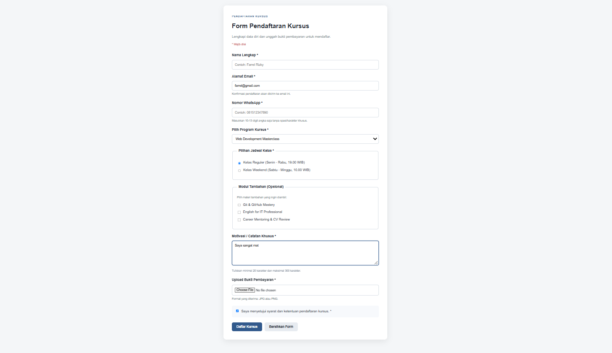
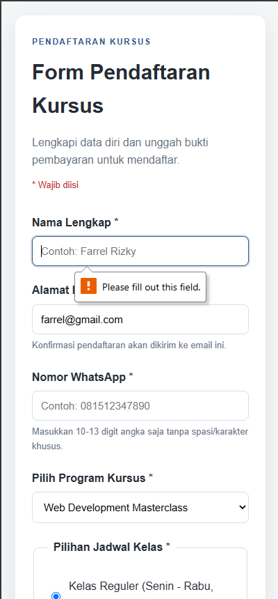

# Tugas Pertemuan 8 - HTML Form Lanjutan: Radio, Checkbox, Select, Textarea, Upload, dan Validasi

## Biodata Mahasiswa
- **Nama:** Muhammad Farrel Rizky
- **NPM:** 4525210117
- **Program Studi:** Teknik Informatika
- **Universitas:** Universitas Pancasila
- **Mata Kuliah:** Desain Web
- **Kelas:** A
- **Pertemuan:** 8 - HTML Form Lanjutan: Radio, Checkbox, Select, Textarea, Upload, dan Validasi

---

## Deskripsi Tugas & Perintah
**Tugas Individu:**
Membuat form pendaftaran kursus dengan elemen `radio`, `checkbox`, `select`, `textarea`, `upload` pembayaran, 3 jenis button, dan minimal 4 aturan validasi. Menguji minimal 5 skenario input salah, lalu menyusun *test case* validasi: *field*, *input* uji, hasil yang diharapkan, dan hasil aktual. Menjelaskan validasi mana yang tetap wajib dilakukan di server.

**Bukti yang Dikumpulkan:**
1. Source code / folder project.
2. Screenshot hasil pada desktop dan mobile (menampilkan kondisi untuk skenario input yang salah).
3. Penjelasan mengenai setiap perubahan, masalah, dan solusi.

---

## Struktur Project
```
Tugas/
├── index.html          -> halaman form pendaftaran kursus
├── css/
│   └── style.css       -> tampilan form dan layout responsif
├── Screenshot/
│   ├── Dekstop.png     -> tampilan desktop
│   └── Mobile.png      -> tampilan mobile
└── README.md           -> laporan ini
```

---

## Elemen Form yang Digunakan

Form dikirim dengan `method="post"` ke `/proses-pendaftaran`. Atribut `enctype="multipart/form-data"` wajib ada agar file bukti pembayaran ikut terkirim.

| Elemen | Field | Keterangan |
|---|---|---|
| `input type="text"` | Nama Lengkap, Nomor WhatsApp | Teks biasa dengan aturan validasi |
| `input type="email"` | Alamat Email | Browser memeriksa format email |
| `select` | Pilih Program Kursus | 4 pilihan kursus. Opsi pertama bernilai kosong sebagai *placeholder* |
| `input type="radio"` | Pilihan Jadwal Kelas | Reguler atau Weekend, hanya bisa memilih satu (`name="jadwal"` sama) |
| `input type="checkbox"` | Modul Tambahan | Boleh memilih lebih dari satu (`name="modul_tambahan[]"`), sifatnya opsional |
| `textarea` | Motivasi / Catatan Khusus | Teks panjang, 5 baris |
| `input type="file"` | Upload Bukti Pembayaran | Dibatasi `accept=".jpg,.jpeg,.png"` |
| `input type="checkbox"` | Persetujuan syarat dan ketentuan | Wajib dicentang |
| `fieldset` + `legend` | Kelompok radio dan checkbox | Mengelompokkan pilihan yang berkaitan |
| `label for` | Semua field | Menghubungkan teks label dengan input lewat `id` |

### Tiga Jenis Button

| Jenis | Kode | Fungsi |
|---|---|---|
| Submit | `<button type="submit" class="btn btn-primary">Daftar Kursus</button>` | Mengirim form setelah semua validasi terpenuhi |
| Reset | `<button type="reset" class="btn btn-secondary">Bersihkan Form</button>` | Mengosongkan semua isian form |
| Button biasa | `<button type="button" class="btn btn-outline">Kembali</button>` | Tidak mengirim dan tidak mengosongkan form |

---

## Aturan Validasi HTML5

Form memakai lebih dari 4 aturan validasi:

| No | Aturan | Dipakai pada | Fungsi |
|:--:|---|---|---|
| 1 | `required` | Nama, Email, WhatsApp, Kursus, Jadwal, Catatan, Bukti Pembayaran, Persetujuan | Field tidak boleh kosong |
| 2 | `type="email"` | Alamat Email | Memeriksa format email (harus ada `@`) |
| 3 | `minlength` | Nama (3), WhatsApp (10), Catatan (20) | Batas minimal jumlah karakter |
| 4 | `maxlength` | Nama (60), WhatsApp (13), Catatan (300) | Batas maksimal jumlah karakter |
| 5 | `pattern="[0-9]{10,13}"` | Nomor WhatsApp | Hanya boleh angka sebanyak 10 sampai 13 digit |
| 6 | `accept=".jpg,.jpeg,.png"` | Upload Bukti Pembayaran | Membatasi jenis file pada jendela pemilih file |

---

## Hasil Screenshot (Desktop & Mobile)

### 1. Tampilan Desktop
**Form Pendaftaran Kursus (kondisi input belum lengkap / salah):**



Pada tampilan desktop, form berada di tengah halaman dalam satu kartu dengan lebar maksimal 780px. Pada screenshot ini, Nama dan Nomor WhatsApp masih kosong, isian Motivasi baru berisi teks pendek (kurang dari 20 karakter), dan berkas bukti pembayaran belum dipilih. Kondisi ini akan ditolak browser saat tombol **Daftar Kursus** ditekan.

### 2. Tampilan Mobile
**Form Pendaftaran Kursus (skenario Nama dikosongkan):**



Pada tampilan mobile, kartu form memenuhi lebar layar dengan padding yang lebih kecil dan semua field tersusun satu kolom. Saat Nama dikosongkan lalu form dikirim, browser memblokir pengiriman, memfokuskan kursor ke field Nama, dan menampilkan pesan *"Please fill out this field."*

---

## Tabel Test Case Validasi

Pengujian dilakukan di browser (Chromium) dengan skenario input salah berikut:

| No | Field / Input | Input Uji (Salah) | Hasil yang Diharapkan | Hasil Aktual | Status |
|:--:|---|---|---|---|:--:|
| 1 | **Nama Lengkap** | Dikosongkan lalu menekan Submit | Form tidak terkirim dan muncul peringatan field wajib diisi | Browser menolak dan menampilkan *"Please fill out this field."* | Sesuai |
| 2 | **Nama Lengkap** | Mengetik 2 huruf (`Fa`) | Ditolak karena kurang dari 3 karakter (`minlength="3"`) | Browser menampilkan *"Please lengthen this text to 3 characters or more (you are currently using 2 characters)."* | Sesuai |
| 3 | **Alamat Email** | `farrelgmail.com` (tanpa `@`) | Ditolak karena format email tidak valid (`type="email"`) | Browser menampilkan *"Please include an '@' in the email address. 'farrelgmail.com' is missing an '@'."* | Sesuai |
| 4 | **Nomor WhatsApp** | `08123` (kurang dari 10 digit) | Ditolak karena tidak sesuai `pattern="[0-9]{10,13}"` | Browser menampilkan *"Please match the requested format."* | Sesuai |
| 5 | **Nomor WhatsApp** | `0812abc34567` (mengandung huruf) | Ditolak karena hanya boleh angka | Browser menampilkan *"Please match the requested format."* | Sesuai |
| 6 | **Program Kursus** | Dibiarkan pada `-- Pilih Kursus --` | Ditolak karena opsi bernilai kosong | Browser menampilkan *"Please select an item in the list."* | Sesuai |
| 7 | **Jadwal Kelas** | Tidak memilih radio apa pun | Ditolak karena salah satu radio wajib dipilih | Browser menampilkan *"Please select one of these options."* | Sesuai |
| 8 | **Motivasi / Catatan** | `Saya sangat mat` (15 karakter) | Ditolak karena kurang dari 20 karakter (`minlength="20"`) | Browser menampilkan *"Please lengthen this text to 20 characters or more (you are currently using 15 characters)."* | Sesuai |
| 9 | **Bukti Pembayaran** | Tidak memilih file | Ditolak karena file wajib diunggah | Browser menampilkan *"Please select a file."* | Sesuai |
| 10 | **Persetujuan** | Checkbox tidak dicentang | Ditolak karena wajib dicentang | Browser menampilkan *"Please check this box if you want to proceed."* | Sesuai |
| 11 | **Bukti Pembayaran** | Memilih file `.exe` (dengan mengganti filter pemilih file ke *All files*) | Ditolak karena bukan JPG atau PNG | **Lolos validasi browser.** `accept` hanya memfilter jendela pemilih file, tidak memblokir file yang tetap dipilih | **Perlu validasi server** |

**Catatan hasil pengujian:** 10 dari 11 skenario berhasil dicegah oleh validasi browser. Skenario nomor 11 menunjukkan bahwa validasi sisi klien tidak cukup, sehingga pengecekan tipe file wajib diulang di server.

---

## Penjelasan Validasi Sisi Server (Server-Side Validation)

### Mengapa Validasi Server Tetap Wajib?
Validasi HTML5 hanya berjalan di browser pengguna, sehingga hanya berfungsi sebagai kemudahan bagi pengguna, bukan sebagai pengaman. Validasi ini dapat dilewati dengan cara:
1. Mengubah atau menghapus atribut `required`, `pattern`, dan `maxlength` lewat *Inspect Element* (Developer Tools).
2. Mengirim *request* POST langsung dengan Postman, cURL, atau skrip bot tanpa lewat form sama sekali.
3. Memilih file dengan ekstensi terlarang, seperti terbukti pada skenario nomor 11.

Data dari browser harus dianggap **tidak tepercaya** sampai diperiksa ulang oleh server pada alamat tujuan form (`/proses-pendaftaran`).

### Validasi yang Tetap Wajib di Server

| No | Yang Diperiksa | Alasan |
|:--:|---|---|
| 1 | **Field wajib terisi** (nama, email, WhatsApp, kursus, jadwal, catatan, persetujuan) | Atribut `required` bisa dihapus atau dilewati |
| 2 | **Format email** | `type="email"` hanya memeriksa pola dasar, tidak memastikan email benar-benar ada |
| 3 | **Nomor WhatsApp**: hanya angka, 10 sampai 13 digit | `pattern` bisa dilewati dengan *request* langsung |
| 4 | **Panjang teks**: nama 3-60 karakter, catatan 20-300 karakter | `minlength` dan `maxlength` hanya berlaku di browser |
| 5 | **Nilai pilihan sesuai daftar yang diizinkan** (*whitelist*): `kursus` hanya `web-dev`, `ui-ux`, `data-science`, `cyber-security`; `jadwal` hanya `reguler` atau `weekend`; `modul_tambahan[]` hanya `git`, `english`, `career` | Penyerang dapat mengirim nilai di luar opsi yang tampil di form |
| 6 | **File upload**: periksa tipe MIME dan isi file yang sebenarnya, bukan hanya ekstensi namanya | `accept` hanya memfilter jendela pemilih file, dan ekstensi bisa dipalsukan (contoh: `virus.exe` diganti nama menjadi `bukti.jpg`) |
| 7 | **Ukuran file**: tetapkan batas maksimal | Mencegah unggahan file raksasa yang membebani server (serangan *Denial of Service*) |
| 8 | **Penyimpanan file aman**: ganti nama file dengan nama acak dan simpan di luar folder yang bisa diakses publik | Mencegah file berbahaya dijalankan lewat URL |
| 9 | **Sanitasi teks** (*escape* output) pada nama dan catatan | Mencegah serangan **XSS** (*Cross-Site Scripting*) |
| 10 | **Query database memakai *prepared statement*** | Mencegah serangan **SQL Injection** |
| 11 | **Pengecekan duplikasi**: email atau nomor WhatsApp yang sudah terdaftar | Browser tidak punya akses ke data di database |
| 12 | **Token CSRF dan pembatasan jumlah kiriman** (*rate limit*) | Mencegah pengiriman form palsu atau otomatis oleh bot |

**Kesimpulan:** validasi di browser dipakai untuk kenyamanan pengguna (umpan balik cepat), sedangkan validasi di server dipakai untuk keamanan. Keduanya dipakai bersamaan, dan validasi server tidak boleh dihilangkan.

---

## Penjelasan Perubahan, Masalah, dan Solusi

### 1. Perubahan yang Dilakukan
- Membuat `index.html` berisi form pendaftaran kursus dengan elemen `select`, `radio`, `checkbox`, `textarea`, dan `file`, serta tiga jenis button (`submit`, `reset`, dan `button`).
- Membuat `css/style.css` dengan variabel warna (`:root`), tampilan kartu form, dan layout responsif memakai *media query* `max-width: 600px`.
- Menambahkan aturan validasi HTML5: `required`, `type="email"`, `minlength`, `maxlength`, `pattern`, dan `accept`.
- Mengelompokkan `radio` dan `checkbox` memakai `fieldset` dan `legend`, serta menghubungkan setiap label dengan input memakai `for` dan `id`.
- Menambahkan teks bantuan (`<small>`) di bawah field yang aturannya perlu dijelaskan, misalnya format nomor WhatsApp dan batas karakter catatan.

### 2. Masalah yang Dihadapi
- **Nomor WhatsApp masih menerima huruf:** input biasa tanpa pola membolehkan huruf dan jumlah digit yang tidak konsisten.
- **Pilihan modul tambahan lebih dari satu:** beberapa checkbox dengan `name` berbeda menyulitkan pengolahan data di server.
- **Upload file tidak sepenuhnya terkunci:** atribut `accept` ternyata hanya memfilter jendela pemilih file. Pada pengujian, file `.exe` tetap lolos validasi browser setelah filter diganti ke *All files*.
- **Tampilan mobile:** dua tombol yang sejajar terlalu sempit di layar kecil, dan padding kartu yang besar membuat ruang isian menyempit.
- **Nama folder CSS tidak konsisten:** `index.html` memanggil `css/style.css` (huruf kecil), sedangkan folder yang dibuat bernama `CSS`. Di Windows tetap terbaca, tetapi di Linux atau hosting (misalnya GitHub Pages) CSS tidak termuat karena nama berkas membedakan huruf besar dan kecil.

### 3. Solusi yang Diterapkan
- Menambahkan `pattern="[0-9]{10,13}"` bersama `minlength="10"` dan `maxlength="13"` pada nomor WhatsApp, sehingga hanya angka sebanyak 10 sampai 13 digit yang diterima.
- Memberi semua checkbox modul `name="modul_tambahan[]"` yang sama, sehingga pilihan terkirim sebagai satu daftar.
- Menjelaskan pada bagian server-side bahwa jenis file harus diperiksa ulang di server (tipe MIME, isi file, dan ukuran), karena `accept` hanya membantu pengguna.
- Menambahkan `@media (max-width: 600px)`: margin container dikecilkan, padding kartu menjadi 24px, tombol disusun vertikal (`flex-direction: column`) dengan lebar 100%.
- Menyamakan nama folder menjadi `css` (huruf kecil) agar sesuai dengan penulisan di `index.html`.

---

## Catatan
- Pesan validasi (*"Please fill out this field"*, dan seterusnya) berasal dari browser, sehingga teksnya bisa berbeda tergantung browser dan bahasa yang dipakai.
- Form ini mengarah ke `/proses-pendaftaran` yang belum dibuat, karena tugas ini fokus pada sisi tampilan dan validasi di browser.