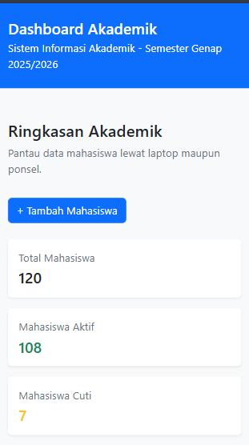
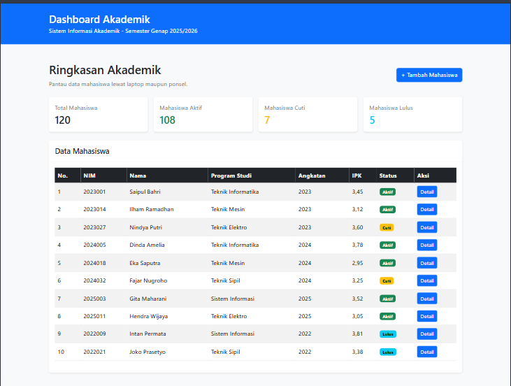
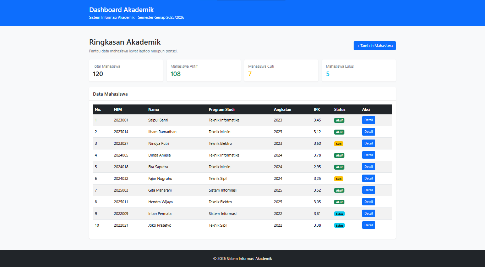

# Tugas Pertemuan 9 - Bootstrap Framework: Grid System dan Table Responsif

## Biodata Mahasiswa
- **Nama:** Muhammad Farrel Rizky
- **NPM:** 4525210117
- **Program Studi:** Teknik Informatika
- **Universitas:** Universitas Pancasila
- **Mata Kuliah:** Desain Web
- **Kelas:** A
- **Pertemuan:** 9 - Bootstrap Framework: Grid System dan Table Responsif

---

## Deskripsi Tugas & Perintah
**Tugas Individu:**
Membuat halaman **Dashboard Akademik** menggunakan Bootstrap 5 yang dipasang melalui CDN, berisi:
1. 4 *statistic cards* yang berubah **1 → 2 → 4 kolom** sesuai ukuran layar (grid system dan breakpoint).
2. Tabel data mahasiswa minimal **10 baris** dengan class `table-striped`, `table-hover`, dan `table-responsive`.
3. Minimal **3 utility classes**, serta **badge** atau **button** sebagai pelengkap.
4. Penjelasan fungsi **container**, **row**, dan **column** pada halaman yang dibuat.

**Bukti yang Dikumpulkan:**
1. Source code / folder project.
2. Screenshot hasil pada tiga ukuran layar: HP, tablet, dan laptop.
3. Penjelasan mengenai setiap perubahan, masalah, dan solusi.

---

## Struktur Project
```
tugas-dashboard-akademik/
├── index.html          -> halaman dashboard
├── css/
│   └── style.css       -> CSS sendiri (dipanggil setelah Bootstrap)
├── Screenshot/         -> bukti tampilan HP, tablet, dan laptop
└── README.md           -> laporan ini
```

---

## Komponen dan Class Bootstrap yang Digunakan

| Bagian Halaman | Class Bootstrap | Keterangan |
|---|---|---|
| Header | `bg-primary text-white py-4` | Utility warna latar, warna teks, dan jarak |
| Isi halaman | `container my-5` | Pembungkus dan jarak atas-bawah |
| Judul + tombol tambah | `row align-items-center`, `col-12 col-md-8`, `col-12 col-md-4 text-md-end` | Judul di kiri, tombol di kanan pada layar tablet ke atas |
| 4 statistic cards | `row g-3`, `col-12 col-md-6 col-lg-3`, `card h-100 shadow-sm`, `card-body` | Grid responsif 1 → 2 → 4 kolom |
| Label dan angka kartu | `text-secondary`, `h3`, `text-success`, `text-warning`, `text-info` | Utility warna teks |
| Tabel | `table-responsive`, `table table-striped table-hover align-middle`, `table-dark` | Tabel responsif dengan baris selang-seling dan efek hover |
| Status | `badge text-bg-success` / `text-bg-warning` / `text-bg-info` | Aktif (hijau), Cuti (kuning), Lulus (biru muda) |
| Aksi | `btn btn-sm btn-primary` | Tombol Detail berukuran kecil |
| Footer | `bg-dark text-white text-center py-4` | Footer halaman |

**Utility classes yang dipakai (syarat minimal 3):** `bg-primary`, `text-white`, `py-4`, `my-5`, `mb-4`, `shadow-sm`, `text-secondary`, `text-center`, `text-md-end`, `mt-3`, `mt-md-0`, `h-100`.

**Pelengkap (syarat badge atau button):** badge status pada setiap baris tabel, tombol "+ Tambah Mahasiswa", dan tombol "Detail" pada setiap baris.

### Isi `css/style.css`
```css
body {
   min-height: 100vh;
}
.card {
   border: 0;
}
table th {
   white-space: nowrap;
}
table td {
   white-space: nowrap;
}
```
- `min-height: 100vh` pada `body` menjaga halaman minimal setinggi layar.
- `border: 0` pada `.card` menghilangkan garis tepi kartu, sehingga hanya bayangan `shadow-sm` yang tampak.
- `white-space: nowrap` pada sel tabel mencegah teks turun baris. Sisa lebarnya ditangani `table-responsive`.

---

## Fungsi Container, Row, dan Column pada Halaman

Tata letak Bootstrap dibangun dari tiga lapis yang bersarang:

| Lapisan | Class | Pada halaman ini | Fungsi |
|---|---|---|---|
| Pembungkus | `container` | `<main class="container my-5">`, juga di dalam header dan footer | Mengatur lebar maksimum isi dan menaruh konten di tengah halaman |
| Baris | `row` | `<div class="row g-3 mb-4">` yang membungkus keempat kartu | Mengelompokkan kolom secara horizontal. `g-3` mengatur jarak antar kolom |
| Kolom | `col-*` | `col-12 col-md-6 col-lg-3` pada tiap kartu | Unit tata letak di dalam baris. Satu baris punya 12 kolom, lebar kolom diatur dengan pembagian dari 12 |

### Cara kerja `col-12 col-md-6 col-lg-3`
Class dibaca per breakpoint dengan prinsip *mobile-first*: class tanpa kode berlaku untuk layar kecil, lalu ditimpa oleh class `md` dan `lg` saat layar membesar.

| Ukuran layar | Class yang aktif | Perhitungan | Hasil |
|---|---|---|---|
| HP (< 768px) | `col-12` | 12 ÷ 12 = 1 | 1 kartu per baris (lebar penuh) |
| Tablet (≥ 768px) | `col-md-6` | 12 ÷ 6 = 2 | 2 kartu per baris |
| Laptop (≥ 1024px) | `col-lg-3` | 12 ÷ 3 = 4 | 4 kartu per baris |

---

## Hasil Screenshot (HP, Tablet, dan Laptop)

### 1. Tampilan HP (lebar 375px) - kartu 1 kolom


Pada layar HP, class `col-12` aktif sehingga keempat kartu tersusun satu per baris. Tombol "+ Tambah Mahasiswa" turun ke bawah judul.

### 2. Tampilan Tablet (lebar 768px) - kartu 2 kolom


Pada lebar 768px, class `col-md-6` aktif sehingga kartu tersusun 2 per baris. Tombol "+ Tambah Mahasiswa" pindah ke sisi kanan judul (`col-md-4 text-md-end`).

### 3. Tampilan Laptop (lebar 1280px) - kartu 4 kolom


Pada lebar 1280px, class `col-lg-3` aktif sehingga keempat kartu tersusun sejajar dalam satu baris.

---

## Tabel Pengujian Layout Responsif

| No | Lebar Layar | Perangkat | Hasil yang Diharapkan | Hasil Aktual | Status |
|:--:|---|---|---|---|:--:|
| 1 | 375px | HP | 4 kartu tersusun 1 per baris | 1 kartu per baris | Sesuai |
| 2 | 768px | Tablet | 4 kartu tersusun 2 per baris | 2 kartu per baris | Sesuai |
| 3 | 1280px | Laptop | 4 kartu tersusun 4 per baris | 4 kartu per baris | Sesuai |
| 4 | 375px | HP | Tabel bisa digeser ke samping, halaman tidak melebar | Tabel digeser di dalam kartu (lebar isi 705px, area tampil 319px), halaman tidak ada scroll horizontal | Sesuai |
| 5 | 768px dan 1280px | Tablet dan laptop | Tabel tampil utuh tanpa scroll horizontal | Seluruh kolom tampil | Sesuai |

---

## Penjelasan Perubahan, Masalah, dan Solusi

### 1. Perubahan yang Dilakukan
Membuat `index.html` dan `css/style.css` untuk Dashboard Akademik. Struktur HTML dan `style.css` mengikuti contoh praktikum (tabel data mahasiswa dengan Bootstrap). Perubahan dari contoh tersebut:
- Kartu statistik ditambah dari 3 menjadi **4 kartu**, dan kolomnya diganti dari `col-md-4` menjadi `col-12 col-md-6 col-lg-3` agar berubah 1 → 2 → 4 kolom.
- Tabel ditambah dari 5 menjadi **10 baris**, dengan tambahan kolom **IPK** dan status baru **Lulus** (badge `text-bg-info`).
- Kartu diberi `h-100` agar tingginya seragam.
- Judul, isi data, dan tema halaman disesuaikan menjadi Dashboard Akademik.

### 2. Masalah yang Dihadapi
- **Tabel terpotong di layar HP:** `style.css` membuat teks sel tidak boleh turun baris (`white-space: nowrap`), sehingga tabel dengan 8 kolom lebih lebar daripada layar HP. Tanpa penanganan, halaman ikut melebar ke samping.
- **Pembagian kolom kartu:** kolom tetap seperti `col-md-4` pada contoh hanya cocok untuk 3 kartu, sedangkan tugas meminta 4 kartu dengan perubahan 1 → 2 → 4 kolom.
- **Tinggi kartu tidak seragam:** kartu dengan isi yang berbeda berpotensi memiliki tinggi yang berbeda.
- **Tampilan tidak responsif di HP tanpa tag viewport:** HP menampilkan halaman seperti layar desktop yang dikecilkan, sehingga breakpoint tidak berfungsi.

### 3. Solusi yang Diterapkan
- Tabel dibungkus `<div class="table-responsive">`, sehingga tabel bisa digeser horizontal di dalam kartu dan halaman tidak melebar (terbukti pada screenshot HP dengan tabel digeser).
- Kolom kartu diganti menjadi `col-12 col-md-6 col-lg-3`: 1 kolom di HP, 2 kolom di tablet, dan 4 kolom di laptop.
- Ditambahkan class `h-100` pada kartu agar semua kartu dalam satu baris sama tinggi.
- Ditambahkan `<meta name="viewport" content="width=device-width, initial-scale=1.0">` pada `<head>`.
- File CSS sendiri (`css/style.css`) dipanggil **setelah** Bootstrap, sehingga aturan buatan sendiri dapat menimpa tampilan bawaan.

---

## Catatan
- Angka pada kartu statistik (120, 108, 7, 5) adalah data contoh. Tabel hanya menampilkan 10 baris sampel, sehingga angkanya tidak dihitung dari tabel.
- Bootstrap dimuat melalui CDN, sehingga komputer harus terhubung internet saat membuka `index.html`.
